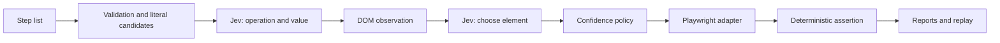

# duit

End-to-end UI test harness: a list of natural-language steps becomes executable browser actions and assertions. **Jev is the only model used at runtime.** Playwright observes and operates the UI; TypeSafe Jev selects operations, existing values, and DOM targets. There is no code generation, chat, translation by another LLM, or fallback provider.

The proof of concept includes a CLI, TypeScript API, browser adapter, executable scenarios, reports, and deterministic replay without a model. It does not include a web editor or a multi-user service.

## Quick start

Requires Node.js 22 or later and a [TypeSafe](https://console.typesafe.ai) API key.

```bash
npm ci
npx playwright install --with-deps chromium
export JEV_API_KEY='your-key'
export DEMO_PASSWORD='demo123'
npm run demo
```

In another terminal, with the same environment variables:

```bash
npm run duit -- run examples/checkout.es.yaml
```

The sample shop listens at `http://127.0.0.1:4173`. This scenario signs in, adds a product, enters an address, chooses shipping, checks a disabled button, accepts the terms, and verifies an asynchronous confirmation. Artifacts are written to a new directory under `artifacts/`.

A plain list of steps works too:

```bash
npm run duit -- run examples/login.en.txt --base-url http://127.0.0.1:4173
```

For an external demo UI:

```bash
export SAUCE_PASSWORD='secret_sauce' # Public SauceDemo credential
npm run duit -- run examples/saucedemo.en.yaml --timeout 15000
# If Chromium needs a proxy in your environment:
npm run duit -- run examples/saucedemo.en.yaml --proxy "$HTTPS_PROXY" --timeout 15000
```

`npm run duit -- --help` lists all options. `npm run build` compiles the library so you can use `node dist/cli.js` without tsx.

## Writing your own cases

```yaml
name: Save profile
baseUrl: https://my-test-environment.example
variables:
  NAME: Ana García
  PASSWORD: env:TEST_PASSWORD
steps:
  - 'Type "${NAME}" into the Name field'
  - "Click Save"
  - 'Verify that the text "Profile saved" appears'
```

JSON and `.txt`/`.md` files with one step per line are also accepted. Text files skip `#` headings and strip leading numbering or bullets. This is not a general Markdown parser.

- Write **one action or assertion per line**. Split “enter details and buy” into observable steps.
- Quoted values are exact. For unquoted text, Jev is offered fragments of up to eight words from the step itself. Jev chooses a fragment; it cannot invent, translate, or calculate values. Prefer quotes to avoid ambiguity.
- Use the visible control name. Instructions may be in English or Spanish; freely translating control names across languages is not reliable in every case.
- Distinguish actions from assertions: “check I agree” changes the checkbox; “verify I agree is checked” only observes it.
- Include at least one explicit assertion. A flow with no checks is `blocked`.
- To verify that text is absent, ask to “Verify that the text \"Error\" is not visible.” `assert_hidden` requires an element that can be identified in the DOM, even if it is hidden.
- In YAML, quote the entire line if it contains `: `; otherwise YAML may parse it as an object.

Available operations:

| Action                                           | Assertion                                        |
| ------------------------------------------------ | ------------------------------------------------ |
| Click, fill/replace text, select a native option | Exact visible / absent text                      |
| Check/uncheck a checkbox, select a radio button  | Element visible / hidden                         |
| Press an explicit key, navigate to a URL/path    | Exact value, checked/unchecked, enabled/disabled |
|                                                  | Exact URL (paths resolve against `baseUrl`)      |

Text assertions use exact matching with Playwright whitespace normalization and accept any visible match. They do not evaluate free-form semantics: “the page looks good” is rejected. Assertions wait up to `--timeout` for asynchronous updates; negative assertions check the observed state, not that something remains absent for a period of time.

## Results and replay

Each run creates a directory that **must not already exist**, containing:

- `report.html`: summary and screenshots for each step.
- `report.json`: steps, actions, duration, errors, requests and typed Jev responses, probabilities, model version, and tokens.
- `junit.xml`: CI integration; `blocked` also produces a failure, never a success.
- `step-*.png`: screenshots with inputs, textareas, and variable values masked.
- `replay.json`: only when the entire case passes; stores actions, assertions, and resolved locators.
- `trace.zip`: only with `--trace`, for Playwright Trace Viewer.

```bash
# Reuse the directory from a previous run:
export EMAIL='ana@example.com'
export DEMO_PASSWORD='demo123'
npm run duit -- replay artifacts/<run>/replay.json
npx playwright show-trace artifacts/<run>/trace.zip
```

Replay does not require `JEV_API_KEY` and does not call a model. Inline variables are exported as `env:NAME` references so their values are not persisted in the plan; existing `env:OTHER_NAME` references are retained. Replay is a reproducible test using observed locators, not an automatic repair mechanism. If the DOM changes, it should fail and be reviewed or resolved again in live mode. Plans do not replace a fixture that prepares or restores the backend.

Exit codes: `0` passed, `1` action/assertion failed, `2` blocked/configuration error. Low confidence is not reported as a confirmed application bug.

## Configuration

| Setting                          | Default                                                         |
| -------------------------------- | --------------------------------------------------------------- |
| `JEV_API_KEY`                    | Required only in live mode                                      |
| `JEV_MODEL`                      | `jev-1.14.0`, pinned version                                    |
| `JEV_ENDPOINT`                   | `https://api.typesafe.ai/v1/systemone`                          |
| `DUIT_BROWSER_PROXY` / `--proxy` | Direct browser connection                                       |
| `--browser`                      | `chromium`; also `firefox`, `webkit` if installed               |
| `--timeout`                      | 5000 ms per action/assertion                                    |
| `--budget`                       | 300000 ms per run                                               |
| `--min-probability`              | 0.70                                                            |
| API policy                       | Minimum margin 0.20 and minimum confidence 0.40                 |
| `--allow-origin`                 | Only the `baseUrl` origin; repeat for SSO/iframes               |
| `--storage-state`                | New context by default; optional authenticated Playwright state |
| `--no-screenshots`               | Disable screenshots                                             |

The Jev API respects `HTTP_PROXY`, `HTTPS_PROXY`, `NO_PROXY`, and Node's CA trust. Configure the browser proxy separately. TLS is not disabled. Only transient transport/HTTP errors are retried, within a budget and with backoff; clicks and form submissions are never retried.

## Architecture and extension



`src/core` does not depend on Playwright or the TypeSafe HTTP API. `DecisionProvider` defines decisions and `PlatformAdapter` defines observation, execution, and evidence. The operation catalog is explicit and typed. Another adapter can be implemented for a different platform while reusing the runner and reports; generating candidates and defining that platform's action vocabulary require implementation work, not just a configuration change. See [docs/architecture.md](docs/architecture.md) for details.

Example integration after building:

```ts
import {
  loadCase,
  runCase,
  JevProvider,
  BrowserAdapter,
} from "./dist/index.js";

const provider = new JevProvider({ model: "jev-1.14.0" });
try {
  const report = await runCase(
    await loadCase("examples/invalid-login.es.yaml"),
    {
      provider,
      platform: new BrowserAdapter({ timeoutMs: 5000 }),
      policy: { minProbability: 0.8 },
      onStep: (step) => console.log(step.status, step.text),
    },
  );
  console.log(report.status, report.artifactsDir);
} finally {
  await provider.close();
}
```

## Verification

```bash
npm run check      # Library, CLI, examples, and test types
npm run build
npm test           # Local tests + real Chromium; no model API
npm run test:live  # Real API, requires JEV_API_KEY and consumes tokens
```

The live suite starts and stops its own local shop; `npm run demo` is not required. It checks positive cases and one false assertion. It uses no mock fallback. CI runs offline tests; live tests are started manually with a repository secret. Measured results and limitations: [docs/feasibility.md](docs/feasibility.md).

## Scope and data

This proof of concept supports conventional DOM flows with atomic steps and explicit data. It includes present iframes with stable order and open shadow DOM. It does not cover canvas, closed shadow DOM, file uploads, drag-and-drop, captchas, interactive MFA, popups/multiple tabs, extracting unknown values for later steps, or open-ended goals that require planning. Initial observation does not implement an autonomous search/repair loop; a control that does not yet exist can result in `blocked`. The adapter approximates accessible names and should be evaluated against each UI.

The model receives steps and descriptions of DOM candidates. It does not receive screenshots or input values from the extractor. Variables are resolved locally and their values are redacted from requests and reports; use `${VARIABLE}` for sensitive data. Values written literally in steps and other page content may be persisted or sent. Opt-in traces are **not redacted** and may contain DOM, network data, and secrets. Masked screenshots are not a general guarantee that PII has been removed. Store artifacts according to your project's data policy.

Only navigation to configured origins is allowed; this limits navigation errors but does not make the browser a network sandbox. UI subresources and fetch requests behave normally. Page content is treated as data for decisions; the closed design reduces the possible actions but does not guarantee immunity to prompt injection. No JavaScript from the user or model is generated or executed.
