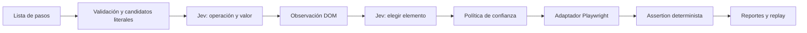

# duit

Harness E2E de UI: una lista de pasos en lenguaje natural se convierte en acciones de navegador y assertions ejecutables. **Jev es el único modelo en runtime**. Playwright observa y opera la UI; TypeSafe Jev selecciona operaciones, valores existentes y objetivos del DOM. No hay generación de código, chat, traducción con otro LLM ni fallback a otro proveedor.

El PoC incluye CLI, API TypeScript, adaptador de navegador, escenarios ejecutables, reportes y replay determinista sin modelo. No incluye un editor web ni un servicio multiusuario.

## Inicio rápido

Requiere Node.js 22 o posterior y una clave de [TypeSafe](https://console.typesafe.ai).

```bash
npm ci
npx playwright install --with-deps chromium
export JEV_API_KEY='tu-clave'
export DEMO_PASSWORD='demo123'
npm run demo
```

En otra terminal, con las mismas variables:

```bash
npm run duit -- run examples/checkout.es.yaml
```

La tienda de prueba escucha en `http://127.0.0.1:4173`. El caso hace login, agrega un producto, completa una dirección, elige envío, verifica un botón deshabilitado, acepta términos y comprueba una confirmación asíncrona. Los artefactos se escriben en una carpeta nueva dentro de `artifacts/`.

Una lista simple también funciona:

```bash
npm run duit -- run examples/login.en.txt --base-url http://127.0.0.1:4173
```

Para una UI externa de demostración:

```bash
export SAUCE_PASSWORD='secret_sauce' # Credencial pública de SauceDemo
npm run duit -- run examples/saucedemo.en.yaml --timeout 15000
# En un entorno que requiere proxy para Chromium:
npm run duit -- run examples/saucedemo.en.yaml --proxy "$HTTPS_PROXY" --timeout 15000
```

`npm run duit -- --help` muestra todas las opciones. `npm run build` compila la biblioteca y permite usar `node dist/cli.js` sin tsx.

## Escribir casos propios

```yaml
name: Guardar perfil
baseUrl: https://mi-entorno-de-test.example
variables:
  NAME: Ana García
  PASSWORD: env:TEST_PASSWORD
steps:
  - 'Escribí "${NAME}" en el campo Nombre'
  - "Hacé clic en Guardar"
  - 'Verificá que aparezca el texto "Perfil guardado"'
```

También se aceptan JSON y archivos `.txt`/`.md` con un paso por línea. En texto se omiten encabezados `#` y se quita la numeración o viñeta inicial. No es un parser general de documentos Markdown.

- Escribí **una acción o una verificación por línea**. Separá “ingresar y comprar” en pasos observables.
- Los valores entre comillas son exactos. Para texto sin comillas, se ofrecen a Jev fragmentos de hasta ocho palabras del propio paso. Jev elige un fragmento; no puede inventar, traducir ni calcular valores. Preferí comillas para evitar ambigüedad.
- Usá el nombre visible del control. Las instrucciones pueden estar en español o inglés; traducir libremente nombres de controles entre idiomas no es confiable en todos los casos.
- Distinguí acciones y assertions: “marcar Acepto” modifica el checkbox; “verificar que Acepto esté marcado” sólo observa.
- Incluí al menos una assertion explícita. Un flujo sin verificaciones queda `blocked`.
- Para verificar texto ausente, pedí “Verificá que no se vea el texto \"Error\"”. `assert_hidden` requiere un elemento que se pueda identificar en el DOM, aunque esté oculto.
- En YAML, entrecomillá la línea completa si contiene `: `; de lo contrario YAML puede interpretarla como un objeto.

Operaciones disponibles:

| Acción                                                | Verificación                                         |
| ----------------------------------------------------- | ---------------------------------------------------- |
| Click, escribir/reemplazar, seleccionar opción nativa | Texto exacto visible / ausente                       |
| Marcar/desmarcar checkbox, seleccionar radio          | Elemento visible / oculto                            |
| Presionar tecla explícita, navegar a URL/ruta         | Valor exacto, checked/unchecked, enabled/disabled    |
|                                                       | URL exacta (las rutas se resuelven contra `baseUrl`) |

Las assertions de texto usan coincidencia exacta con la normalización de espacios de Playwright y aceptan cualquier coincidencia visible. No evalúan semántica libre: “la página se ve bien” se rechaza. Las assertions esperan hasta `--timeout` para tolerar actualizaciones asíncronas; las negativas comprueban el estado observado, no que algo permanezca ausente durante un intervalo.

## Resultados y replay

Cada ejecución crea una carpeta **que no debe existir previamente** con:

- `report.html`: resumen y screenshots por paso.
- `report.json`: pasos, acciones, duración, errores, peticiones y respuestas tipadas de Jev, probabilidades, versión del modelo y tokens.
- `junit.xml`: integración CI; `blocked` también produce un fallo, nunca éxito.
- `step-*.png`: screenshots con inputs, textareas y valores de variables enmascarados.
- `replay.json`: sólo si el caso completo pasó; conserva acciones, assertions y localizadores resueltos.
- `trace.zip`: sólo con `--trace`, para Playwright Trace Viewer.

```bash
# Reutiliza la carpeta indicada por la ejecución anterior:
export EMAIL='ana@example.com'
export DEMO_PASSWORD='demo123'
npm run duit -- replay artifacts/<ejecucion>/replay.json
npx playwright show-trace artifacts/<ejecucion>/trace.zip
```

El replay no requiere `JEV_API_KEY` y no llama a ningún modelo. Las variables inline se exportan como `env:NOMBRE` para no persistir sus valores en el plan; las referencias `env:OTRO_NOMBRE` se conservan. Es un test reproducible con los localizadores observados, no un mecanismo de reparación automática. Si cambia el DOM, debe fallar y revisarse o volverse a resolver en modo live. Los planes no sustituyen una fixture que prepare/restaure el backend.

Códigos de salida: `0` passed, `1` acción/assertion fallida, `2` blocked/error de configuración. Una falta de confianza no se presenta como un bug confirmado de la aplicación.

## Configuración

| Configuración                    | Predeterminado                                          |
| -------------------------------- | ------------------------------------------------------- |
| `JEV_API_KEY`                    | Obligatoria sólo en live                                |
| `JEV_MODEL`                      | `jev-1.14.0`, versión fija                              |
| `JEV_ENDPOINT`                   | `https://api.typesafe.ai/v1/systemone`                  |
| `DUIT_BROWSER_PROXY` / `--proxy` | Conexión directa de navegador                           |
| `--browser`                      | `chromium`; también `firefox`, `webkit` si se instalan  |
| `--timeout`                      | 5000 ms por acción/assertion                            |
| `--budget`                       | 300000 ms por ejecución                                 |
| `--min-probability`              | 0.70                                                    |
| Política en API                  | Margen mínimo 0.20 y confianza mínima 0.40              |
| `--allow-origin`                 | Sólo el origen de `baseUrl`; repetible para SSO/iframes |
| `--storage-state`                | Contexto nuevo; opcional estado autenticado Playwright  |
| `--no-screenshots`               | Desactiva capturas                                      |

La API de Jev respeta `HTTP_PROXY`, `HTTPS_PROXY`, `NO_PROXY` y la confianza CA de Node. El proxy de navegador se configura por separado. No se desactiva TLS. Se reintentan únicamente errores de transporte/HTTP transitorios, con presupuesto y backoff; nunca clicks ni envíos de formularios.

## Arquitectura y extensión



`src/core` no depende de Playwright ni de la API HTTP de TypeSafe. `DecisionProvider` define las decisiones y `PlatformAdapter` define observación, ejecución y evidencia. El catálogo de operaciones es explícito y tipado. Se puede implementar otro adaptador para una plataforma distinta y reutilizar runner/reportes; la generación de candidatos y el vocabulario de acciones de esa plataforma requieren desarrollo, no basta con cambiar una configuración. Los detalles están en [docs/architecture.md](docs/architecture.md).

Ejemplo de integración después de compilar:

```ts
import {
  loadCase,
  runCase,
  JevProvider,
  BrowserAdapter,
} from "./dist/index.js";

const provider = new JevProvider({ model: "jev-1.14.0" });
try {
  const report = await runCase(
    await loadCase("examples/invalid-login.es.yaml"),
    {
      provider,
      platform: new BrowserAdapter({ timeoutMs: 5000 }),
      policy: { minProbability: 0.8 },
      onStep: (step) => console.log(step.status, step.text),
    },
  );
  console.log(report.status, report.artifactsDir);
} finally {
  await provider.close();
}
```

## Verificación

```bash
npm run check      # Tipos de biblioteca, CLI, ejemplos y tests
npm run build
npm test           # Tests locales + Chromium real; sin API de modelos
npm run test:live  # API real, requiere JEV_API_KEY y consume tokens
```

La suite live inicia/cierra su propia tienda local; no requiere `npm run demo`. Verifica casos positivos y una assertion falsa. No usa mocks como fallback. CI ejecuta los tests offline; el live se activa manualmente con un secret del repositorio. Resultados medidos y límites: [docs/feasibility.md](docs/feasibility.md).

## Alcance y datos

Este PoC funciona para flujos DOM convencionales con pasos atómicos y datos explícitos. Incluye iframes presentes con orden estable y shadow DOM abierto. No cubre canvas, shadow DOM cerrado, carga de archivos, drag-and-drop, captchas, autenticación interactiva MFA, popups/múltiples pestañas, extracción de valores desconocidos para pasos futuros ni objetivos abiertos que requieran planificación. La observación inicial no implementa un ciclo autónomo de búsqueda/reparación; un control que aún no existe puede producir `blocked`. El adaptador usa aproximaciones al nombre accesible y debe evaluarse en cada UI.

El modelo recibe pasos y descripciones de candidatos DOM. No recibe screenshots ni valores de inputs del extractor. Las variables se resuelven localmente y sus valores se redactan en peticiones y reportes; usá `${VARIABLE}` para datos sensibles. Los valores escritos literalmente en pasos y otros contenidos de la página pueden persistirse/enviarse. Las trazas opt-in **no se redactan** y pueden contener DOM, red y secretos. Los screenshots enmascarados no son una garantía general de eliminación de PII. Guardá los artefactos según la política de datos de tu proyecto.

Sólo se permite navegación a los orígenes configurados; esto limita errores de navegación, no convierte el navegador en un sandbox de red. Subrecursos/fetches de la UI conservan su comportamiento normal. El contenido de páginas se trata como datos para las decisiones; el diseño cerrado reduce las acciones posibles pero no garantiza inmunidad a prompt injection. No hay generación ni ejecución de JavaScript proveniente del usuario o del modelo.
